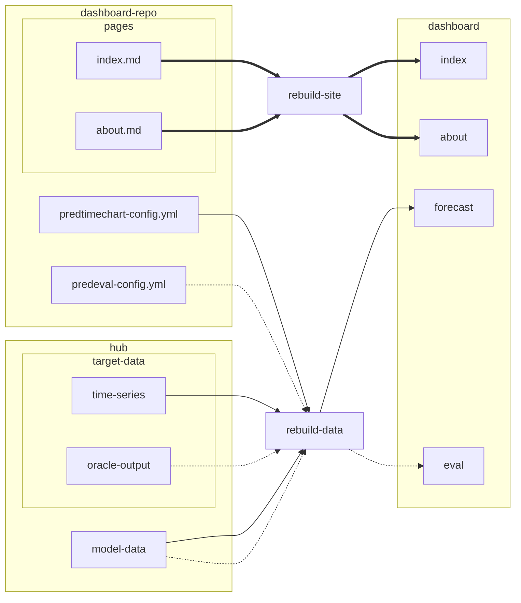

# hub-dashboard-control-room

> [!NOTE]
>
> This project is a proof of concept.

## Overview

This repository contains scripts and re-usable workflows that can be used to
build a hub dashboard that can be maintained separate from a hub.

## Usage

There are two ways to use these workflows:

1. via re-usable workflows (if you can run workflows in your repository)
2. app-based runs (if you are unable to run workflows in your repository)

For both options, you will create a new GitHub repository based on [the hub dashboard
template](https://github.com/new?template_name=hub-dashboard-template&template_owner=hubverse-org).

If you plan to use [the hubDashboard
app](https://github.com/apps/hubdashboard/installations/new), install it on the dashboard repository you just created. Then make a pull request here (`hub-dashboard-control-room`), adding the new dashboard repository name to `known-hubs.json`.

### Re-usable workflows

## Implementation Details



### Tools

There are three tools that are used in this workflow. The processes are described
below

 - [hub-dash-site-builder (Docker container to build the site with quarto)](https://github.com/hubverse-org/hub-dash-site-builder)
 - [hub-dashboard-predtimechart (Python app to build predtimechart data for the forecasts)](https://github.com/hubverse-org/hub-dashboard-predtimechart)
 - [hubPredEvalsData-docker (Docker container to build evaluation data)](https://github.com/hubverse-org/hubPredEvalsData-docker)

These are the generalized steps to generate the data and the site:

### Predtimechart data

The general steps to generate the data for predtimechart are (using the
[`dashboard-test-hub-dashboard`](https://github.com/hubverse-org/dashboard-test-hub-dashboard)
+ [`dashboard-test-hub`](https://github.com/hubverse-org/dashboard-test-hub)
test fixtures as a runnable example):

1. install 
   [hub-dashboard-predtimechart](https://github.com/hubverse-org/hub-dashboard-predtimechart)
   via
   ```bash
   pip install --upgrade pip
   pip install git+https://github.com/hubverse-org/hub-dashboard-predtimechart
   ```
2. clone the dashboard repository and enter it (you only need the `predtimechart-config.yml`)
   ```bash
   git clone https://github.com/hubverse-org/dashboard-test-hub-dashboard
   cd dashboard-test-hub-dashboard
   ```
3. clone the hub repository into `repo/`
   ```bash
   git clone https://github.com/hubverse-org/dashboard-test-hub repo
   ```
4. Generate the Predtimechart data
   ```bash
   mkdir -p out/targets/
   mkdir -p out/forecasts/
   ptc_generate_target_json_files \
     repo \
     predtimechart-config.yml \
     out/targets
   ptc_generate_json_files \
     repo \
     predtimechart-config.yml \
     out/predtimechart-options.json \
     out/forecasts
   ```
5. enter `repo/` and checkout the `ptc/data` branch
6. copy the contents of `../data` to your current folder
7. add, commit, and push

### Evals Data

Oracle output is auto-discovered from the hub's
[`target-data/`](https://docs.hubverse.io/en/latest/user-guide/target-data.html)
directory via `hubData::connect_target_oracle_output()`, which supports CSV,
parquet, and partitioned parquet.

1. clone the dashboard repository and enter it (you only need the `predevals-config.yml`)
   ```bash
   git clone https://github.com/hubverse-org/dashboard-test-hub-dashboard
   cd dashboard-test-hub-dashboard
   ```
2. clone the hub repository into `repo/`
   ```bash
   git clone https://github.com/hubverse-org/dashboard-test-hub repo
   ```
3. Run the container:
   ```bash
   docker run \
     --platform=linux/amd64 \
     --rm \
     -ti \
     -v "$(pwd)":"/site" \
     ghcr.io/hubverse-org/hubpredevalsdata-docker:latest \
     create-predevals-data.R \
       -h repo \
       -c predevals-config.yml \
       -o out
   ```
4. enter the dashboard repo and checkout the `predevals/data` branch
5. copy the contents of `../out` to your current folder
6. add, commit, and push

### Static Site

The static site is generated via the [hubverse-org/hub-dash-site-builder
container](https://github.com/hubverse-org/hub-dash-site-builder/pkgs/container/hub-dash-site-builder)
and writes a folder called `_site/` under the `pages/` folder of the dashboard
repository. You need to then copy the contents of `_site/` into the `gh-pages`
branch of the dashboard repository. 


1. clone the dashboard repository
2. Run the container:
   ```bash
   docker run \
     --platform=linux/amd64 \
     --rm \
     -ti \
     -v "/path/to/dashboard/repo":"/site" \
     ghcr.io/hubverse-org/hub-dash-site-builder:latest \
     bash render.sh
   ```
3. clone the gh-pages branch of the dashboard repository into `pages/`
4. copy the files from the `dashboard repo/site/pages/_site/` folder into `pages/`
5. push the `pages/` folder up. 

